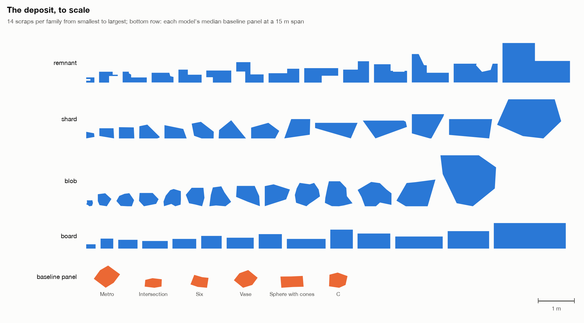
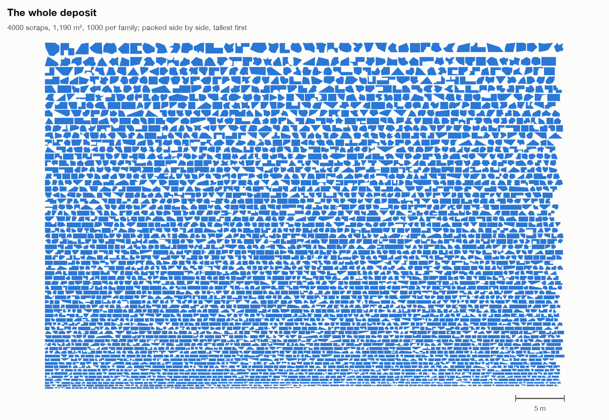
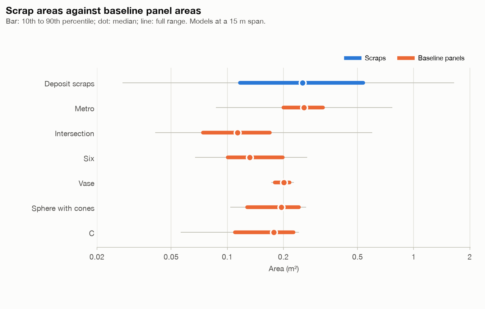
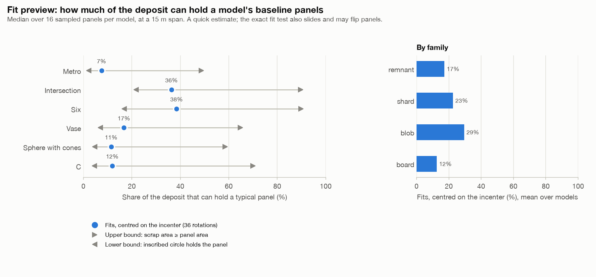

# The stock

The stock is the pile of flat offcuts the shell is built from. This doc covers what is in it, how
it is generated, how it is put on a model, and how well it matches the baseline's panels. For where
it fits in the project, see [plan.md](plan.md) (Phase 1, item 1). The code is in [stock/](../stock/).

## In short

- **One deposit, in meters, shared by every model:**
  [data/stock/deposit_s0.json](../data/stock/deposit_s0.json), 4000 scraps, 1190 m² in all.
- **Four shape families, exactly 1000 scraps each,** all with the same size distribution: remnant,
  shard, blob and board.
- **Size is absolute.** Size means √area. It is lognormal with a median of 0.5 m, cut off at
  0.15–1.5 m; the middle 80% of scraps lie between 0.34 and 0.73 m.
- **Every model is scaled to a 15 m span** (its bounding-box diagonal). PH-CPF's δ stays 0.5% of
  the diagonal, so it is 75 mm on every model.
- **Piece count is never the limit.** The deposit holds 4–16× each model's surface area.
- **Fit limits how large panels can grow.** The quick fit preview below finds that only 7–38% of
  scraps can hold a typical baseline panel centred on their incenter, a lower bound. The exact fit
  test ([matching/fit.py](../matching/fit.py), 2026-11-24) finds that every one of Metro's 436
  baseline panels fits a scrap of its own, and that fit binds only for panels about twice the
  baseline's area or more ([plan.md](plan.md), Phase 2, item 6).



## Commands

Run from the repository root with the project's Python environment
(`~/miniconda3/envs/scrapshell/bin/python`, see [environment.yml](../environment.yml)).

```bash
python -m stock.generate              # writes data/stock/deposit_s0.json (about 10 s)
python -m stock.generate --seed 1 -o /tmp/deposit.json
python -m stock.generate --config my_deposit.json      # see Configuration below
python -m stock.place                 # each model's physical size at the 15 m span, against the deposit
python -m stock.place --span 20
python -m stock.plot                  # figures and the fit preview, in results/stock/
python -m stock.plot --out docs/figures/stock          # how the figures in this doc were made
python -m pytest                      # 130 tests in tests/ (about 10 s)
```

`stock.generate` also takes `--n-scraps N`. `stock.plot` also takes `--deposit FILE`,
`--models ID ...`, `--panels N` (baseline panels sampled per model for the fit preview, default 16)
and `--rotations N` (default 36).

## The deposit

| | |
| --- | --- |
| Scraps | 4000: 1000 remnants, 1000 shards, 1000 blobs, 1000 boards |
| Total area | 1190 m² |
| Size (√area) | median 0.50 m; 10th–90th percentile 0.34–0.73 m; range 0.17–1.28 m |
| Area | median 0.25 m²; 10th–90th percentile 0.12–0.54 m² |
| Seed | 0. Regenerating gives a byte-identical file |
| File | 1.75 MB of JSON, one scrap per line |



## Shape families

Each family draws an outline at unit area. A shared size, drawn separately (see [Sizes](#sizes)),
then scales it to meters, so the families decide only the shape.

| Family | What it looks like | Vertices | Elongation | Fatness | Convexity | Draws accepted |
| --- | --- | ---: | ---: | ---: | ---: | ---: |
| **remnant** | What is left of a sheet after parts were cut from it: L, U, T and notched shapes | 8 | 1.76 | 0.36 | 0.86 | 65% |
| **shard** | One cell of a random Voronoi diagram, like a broken tile. Always convex | 5 | 1.62 | 0.42 | 1.00 | 95% |
| **blob** | An irregular star-shaped polygon, sometimes slightly non-convex | 8 | 1.17 | 0.46 | 0.96 | 100% |
| **board** | A rectangle, like a plank offcut | 4 | 2.09 | 0.35 | 1.00 | 100% |

The four numbers are medians over the deposit. **Elongation** is the long side ÷ the short side of
the smallest enclosing rectangle. **Fatness** is inradius ÷ √area: 0.56 for a disk, 0.5 for a
square, 0.22 for a 5:1 board. **Convexity** is area ÷ convex hull area. **Draws accepted** is the
share of raw draws that pass the [usability limits](#usability-limits); rejected draws are redrawn.

### Family parameters

Lengths are relative to the sheet's short side. The defaults are what the deposit uses.

| Family | Parameter | Default | What it does |
| --- | --- | --- | --- |
| remnant | `aspect_max` | 2.5 | The sheet is W × 1, with W uniform in [1, `aspect_max`] |
| | `n_cuts` | (1, 3) | Number of cuts, uniform in this range |
| | `p_hex` | 0.3 | Chance that a cut is a regular hexagon centred on the sheet's boundary |
| | `hex_size` | (0.25, 0.55) | The hexagon's circumradius |
| | `p_corner` | 0.5 | Chance that a rectangular cut takes a corner (leaving an L); otherwise it is a notch in one edge |
| | `corner_cut` | (0.3, 0.65) | A corner cut's size, as a fraction of each side |
| | `notch_width`, `notch_depth` | (0.2, 0.5), (0.2, 0.6) | A notch's width along its edge and depth across the sheet, as fractions |
| | `min_keep` | 0.35 | Redraw if less than this share of the sheet is left |
| shard | `n_sites` | 10 | Number of Voronoi sites, uniform on the sheet; one of their cells is picked at random |
| | `aspect_max` | 1.5 | The sheet the diagram is clipped to is W × 1, W uniform in [1, `aspect_max`] |
| blob | `n_vertices` | (5, 12) | Vertex count, uniform in this range |
| | `irregularity` | 0.6 | Angular jitter, as a fraction of the even spacing (below 1, so the outline never crosses itself) |
| | `spikiness` | 0.25 | Standard deviation of the radius around 1 (clipped to 0.3–1.7) |
| board | `aspect_median`, `aspect_sigma` | 2.0, 0.5 | The aspect ratio is lognormal with this median and log-standard deviation |
| | `aspect_max` | 5.0 | … conditioned on [1, `aspect_max`] |

### Usability limits

Every scrap must pass these checks, or it is redrawn. They keep out shapes no one would cut a panel
from. Lengths are relative to √area.

| Limit | Default | What it rejects |
| --- | --- | --- |
| `max_vertices` | 16 | Overly detailed outlines |
| `min_fatness` | 0.2 | Slivers: inradius ÷ √area below this |
| `min_edge` | 0.03 | Very short edges |
| `min_angle` | 20° | Interior angles below 20° or above 340° (needle tips and needle-thin slots) |
| `min_feature` | 0.15 | Any part (spike, strip, neck) or notch narrower than this, found by a morphological opening and closing |

Before the checks, each raw outline is simplified at 0.005 × √area, which removes near-collinear
vertices and the slivers that boolean operations leave behind. After the checks, it is moved to a
canonical frame: incenter at the origin, long axis along x.

## Sizes

All scraps' sizes are drawn from one distribution, sorted, and dealt out in consecutive groups of
four, one to each family in random order. Every family therefore gets the same size distribution
(all four family medians are 0.503 m). The ids are then shuffled, so any run of ids is a balanced
sample.

The default is `{"kind": "lognormal", "median": 0.5, "sigma": 0.3, "min": 0.15, "max": 1.5}`, where
sigma is the standard deviation of ln(size). Values outside [min, max] are redrawn, so nothing piles
up at the bounds. Three other kinds are available for ablations:

```json
{"kind": "uniform", "min": 0.2, "max": 1.0}
{"kind": "pareto",  "alpha": 1.5, "min": 0.2, "max": 1.5}
{"kind": "mixture", "components": [{"weight": 0.7, "dist": {...}}, {"weight": 0.3, "dist": {...}}]}
```

The Pareto is truncated to [min, max] and sampled exactly. A mixture's components can be any kind.

## Placing the deposit on a model

The deposit is in meters; the models are in arbitrary units. [stock/place.py](../stock/place.py)
gives every model the same physical size: its bounding-box diagonal (the span) is scaled to 15 m.
PH-CPF's tolerances are fractions of the diagonal, so the baseline's results simply scale with the
model, and δ is 75 mm on every model.

| Model | m per unit | Surface | Baseline panels | Median panel | Stock ÷ surface | Scraps per panel |
| --- | ---: | ---: | ---: | ---: | ---: | ---: |
| Metro | 0.867 | 133.9 m² | 436 | 0.258 m² | 8.9× | 9.2 |
| Intersection | 1.304 | 74.8 m² | 522 | 0.114 m² | 15.9× | 7.7 |
| Six | 0.356 | 77.5 m² | 416 | 0.132 m² | 15.4× | 9.6 |
| Vase | 7.455 | 96.9 m² | 394 | 0.201 m² | 12.3× | 10.2 |
| Three holes | 12.99 | 284.0 m² | — | — | 4.2× | — |
| Car | 0.0308 | 205.0 m² | — | — | 5.8× | — |
| Sphere with cones | 0.255 | 138.9 m² | 714 | 0.195 m² | 8.6× | 5.6 |
| C | 2.624 | 156.4 m² | 889 | 0.177 m² | 7.6× | 4.5 |

Three holes and Car have no baseline panels (they stop at integer rounding), but they can still be
placed, since placement needs only the surface.



## Fit preview

By area, the deposit matches the baseline well: the median scrap (0.25 m²) is about Metro's median
panel and twice Intersection's. But a panel must fit inside a scrap's outline, and notches and
elongation get in the way. `python -m stock.plot` estimates how many scraps can hold a model's
panels. For 16 baseline panels per model, it counts the scraps that pass three tests, from strict
to loose:

1. **Circle:** the scrap's inscribed circle is at least as large as the panel's enclosing circle.
   The first draft of the size field in [plan.md](plan.md) (Phase 1, item 2) was built on this
   coarse test.
2. **Incenter:** the panel, with the centre of its enclosing circle on the scrap's incenter, lies
   inside the scrap at one of 36 rotations.
3. **Area:** the scrap's area is at least the panel's. Necessary, so an upper bound.

Each test implies the next. The exact fit test (Phase 2, item 5) will also slide the panel, and
possibly flip it, so its result will lie between the incenter and area numbers.

| Model | Circle | Incenter | Area | Incenter, by family: remnant / shard / blob / board |
| --- | ---: | ---: | ---: | --- |
| Metro | 2% | 7% | 49% | 5% / 8% / 12% / 4% |
| Intersection | 22% | 36% | 90% | 32% / 40% / 52% / 21% |
| Six | 17% | 38% | 90% | 34% / 43% / 52% / 26% |
| Vase | 7% | 17% | 65% | 13% / 17% / 24% / 12% |
| Sphere with cones | 5% | 11% | 58% | 9% / 13% / 18% / 6% |
| C | 5% | 12% | 70% | 10% / 14% / 18% / 6% |

Each number is the median over the sampled panels of the share of all 4000 scraps that pass.



What this means:

- **The stock will shape the layout.** On Metro, about 300 scraps can hold a baseline-size panel,
  for 436 panels; stock-driven sizing has to make many of Metro's panels smaller. Intersection and
  Six have over 1400 suitable scraps each and need little change.
- **Compact families fit best.** Blobs (29% on average) and shards (23%) hold hexagonal panels far
  more often than remnants (17%) and boards (12%). A 2:1 board holds a hexagon only as wide as its
  short side.
- **The circle test is too pessimistic.** The incenter test, itself a lower bound, already passes
  1.6–3.4× as many scraps. Sizing panels by scrap inradius alone would waste much of the stock, so
  the size field measures each scrap's capacity by sliding and turning the panel instead
  ([plan.md](plan.md), Phase 1, item 2).

**Decision (2026-11-22): keep the 0.5 m median.** Fitting panels to the stock is the point of the
extension, so the stock should be a real constraint. Raising the median to about 0.7 m, or shrinking
the span to about 10 m, would let most scraps hold a baseline panel and leave little for the size
field to do. We revisit this once the exact fit test exists.

## File format

The deposit is JSON, format `scrapshell-stock/2`. All lengths are in meters, all areas in m².

| Key | Content |
| --- | --- |
| `format` | `"scrapshell-stock/2"`; `load_deposit` rejects anything else |
| `name`, `seed`, `units` | `"deposit_s0"`, `0`, `"m"` |
| `generator` | The resolved configuration: `n_scraps`, `families`, `sizes`, `params`, `limits` |
| `summary` | `count`, `totalArea`, scraps per family, size quantiles (`min`, `p10`, `median`, `p90`, `max`), and `drawAcceptance` per family |
| `scraps` | One object per scrap, below |

Each scrap:

| Key | Content |
| --- | --- |
| `id` | 0 … n−1, in shuffled order |
| `family` | `remnant`, `shard`, `blob` or `board` |
| `size` | √area |
| `polygon` | Counter-clockwise vertices, not closed, with the incenter at the origin and the long axis along x |
| `area`, `perimeter`, `nVertices` | |
| `inradius`, `incenter` | The largest inscribed circle (to within 1e-4 × √area) |
| `circumradius` | The smallest enclosing circle |
| `length`, `width`, `elongation`, `axisAngle` | The smallest-area enclosing rectangle: its sides (length ≥ width), their ratio, and the direction of the long side in radians |
| `convexity` | Area ÷ convex hull area |

Numbers are rounded to 7 significant digits, and the descriptors are computed on the rounded
polygon, so they agree with what a reader recomputes.

## Configuration

`python -m stock.generate --config FILE` reads a JSON file that may set any of `n_scraps`, `sizes`,
`params` (keyword arguments per family) and `limits`; everything else keeps its default. For
example, a deposit with a wider size spread and longer boards:

```json
{
  "sizes": {"kind": "lognormal", "median": 0.5, "sigma": 0.5, "min": 0.15, "max": 2.0},
  "params": {"board": {"aspect_median": 3.0}},
  "limits": {"min_fatness": 0.15}
}
```

| Parameter | Default | What it does |
| --- | --- | --- |
| `n_scraps` | 4000 | Number of scraps; must be a multiple of 4 (one share per family) |
| `sizes` | lognormal, median 0.5 m, sigma 0.3, 0.15–1.5 m | Distribution of √area, in meters ([Sizes](#sizes)) |
| `params` | `{}` | Per-family overrides ([Family parameters](#family-parameters)) |
| `limits` | `{}` | Overrides of the [usability limits](#usability-limits) |
| `--seed` | 0 | Random seed; the output file is named after it |

On the placement side (stock/place.py):

| Parameter | Default | What it does |
| --- | --- | --- |
| `span` | 15 m | Bounding-box diagonal given to every model |
| `delta` | 0.005 | PH-CPF's δ, as a fraction of the diagonal (75 mm at 15 m), as in `runme.m` |

## Reproducibility

One seed drives everything, through independent random streams
(`numpy.random.SeedSequence(seed).spawn`): one for the sizes, one for dealing and shuffling, and
one per family for the shapes. Changing one family's parameters therefore leaves every other
family's scraps exactly as they were. Unknown config keys or families are rejected rather than
ignored.

## Code and tests

| Module | What it does |
| --- | --- |
| [describe.py](../stock/describe.py) | Shape descriptors of a scrap; input validation |
| [shapes.py](../stock/shapes.py) | The four families, the usability checks, the canonical frame |
| [sizes.py](../stock/sizes.py) | Size distributions |
| [generate.py](../stock/generate.py) | The deposit: configuration, sizes, dealing, file format |
| [model_ref.py](../stock/model_ref.py) | Each model's surface area, bounding-box diagonal and flattened baseline panels, read from `web/data/` |
| [place.py](../stock/place.py) | Models at a common span; meters to model units |
| [plot.py](../stock/plot.py) | The figures in this doc and the fit preview |

The tests in [tests/](../tests/) cover each module. Among other things they check descriptors
against shapes with known answers, that every family passes its limits over 1000 draws, size
distributions with Kolmogorov–Smirnov tests, the family balance of the deposit, that a deposit
regenerates identically from its seed, and the ordering circle ≤ incenter ≤ area in the fit preview.
